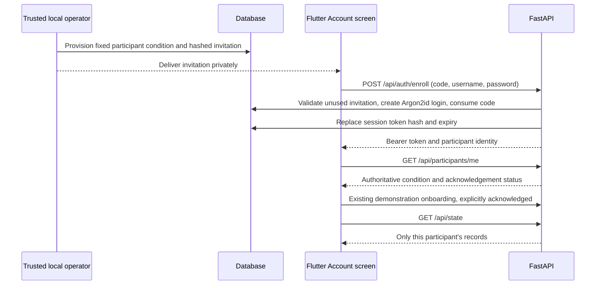
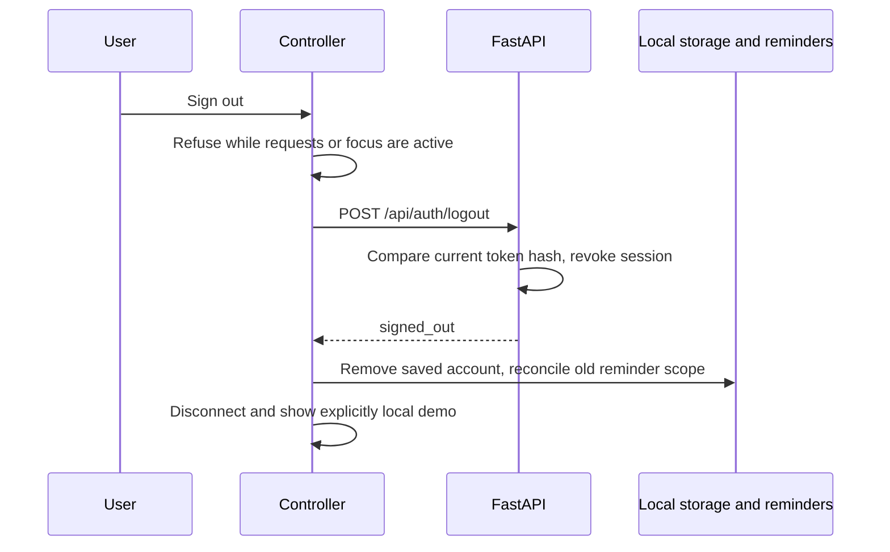

# Authentication and invitations

Use synthetic identities until deployment and research approval are complete. Never send a Gemini key to Flutter. A researcher issues invitations locally; users choose their own username and password.

## Enrollment and login

The Account screen uses the configured `API_BASE_URL`, without an editable server/token field. Create account requires matching password confirmation. Sign-out retains server history; returning login verification and device-only limits are documented in [persistent accounts](PERSISTENT_USER_ACCOUNTS.md). Advanced development connection controls are separate.



Usernames: 3–64 ASCII letters, digits, dot, hyphen or underscore; normalized to lowercase. Passwords: 12–128 characters, not trimmed or normalized. PasswordHasher from `argon2-cffi` supplies Argon2id hashing and verification, including rehash-on-login. Raw passwords are never persisted. Invitation codes are generated with `secrets.token_urlsafe`, hashed with SHA-256, expire after 72 hours by default and are consumed transactionally. They contain no client-selectable assignment.

If enrollment commits but its response is lost, use **Sign in** with the selected username/password; the invitation cannot be consumed twice. If it did not commit, the invitation remains usable. Do not automatically create another participant to recover an ambiguous response.

Sign-in returns a new random bearer token; only its SHA-256 hash is stored server-side. Existing token expiry policy is 7 days by default, configurable 1–90 days. Login can renew an expired session while the participant remains active. It invalidates the previous bearer token immediately. Disabled/erased accounts cannot renew. There are no refresh tokens or cookie sessions, and no password-recovery email mechanism.

## Restoration

```mermaid
sequenceDiagram
  participant F as Flutter
  participant S as Mobile secure storage
  participant API as FastAPI
  F->>S: Read remembered userSession
  S-->>F: Server, token, expected ID and condition
  F->>API: GET /api/participants/me with bearer
  API-->>F: Identity or unauthorized
  alt valid and matches saved identity
    F->>API: GET /api/state (after acknowledgement)
    API-->>F: Owned snapshot
  else expired, revoked, unavailable or mismatched
    F->>F: Block mutations; show reconnect error
  end
```

Mobile uses the existing FlutterSecureStorage implementation. Web uses memory only; a page reload requires sign-in. Ordinary SharedPreferences never receives bearer tokens or passwords. Account caches are separate from credential storage and contain unencrypted research text; secure tokens alone do not secure an entire research device.

## Logout and lifecycle



Offline sign-out removes automatic login locally, but server revocation cannot be promised. A warning is displayed. Pending data stays under its original account cache. Existing local CLI `revoke` disables the participant; `rotate` replaces a token but does not change assignment or reset a password. No web administrator identity was introduced.

## Abuse and deployment controls

The single-worker development API limits authentication attempts to 10 per normalized username and 30 per peer address in ten minutes, including successes, with bounded memory. This limiter resets on process restart and is not distributed. Proxy identity, HTTPS, edge rate limits, monitoring, account recovery and operational auditing need deployment work. Invalid login responses are generic. Request-validation responses identify fields without echoing passwords. Do not enable request-body/header logging.

No experimental assignment, questionnaire, intervention timing or agent prompt was changed. `APP_MODE` remains development-only. A production release requires a separately reviewed operational design.


## Logout cleanup failure handling

The final integration fix adds a non-sensitive `small_steps.login_restore_disabled.v1` device preference. Disconnect marks restoration disabled before attempting secure-vault cleanup, and always removes visible connected state even if vault writes fail. If preferences are available, a stale vault cannot restore that account on the next initialization. Explicit successful remembered sign-in clears the marker. A failure of both preference and secure storage cannot guarantee durable cleanup and produces a warning; do not treat it as confirmed credential deletion. Offline server revocation remains unconfirmed. See [final integration report](FINAL_INTEGRATION_CHECK.md).
