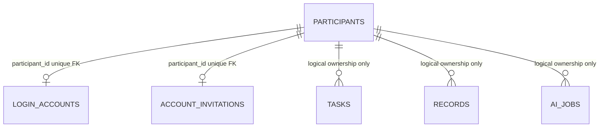

# Multi-user design

Implemented 2026-11-02. This extends the existing participant-owned application; it does not introduce a second task store. See [authentication](AUTHENTICATION.md), [migration](DATABASE_MIGRATIONS.md), and [verification](MULTI_USER_QA_REPORT.md).

## Identity and assignment

`Participant.id` is the pseudonymous record owner and research condition holder. New `LoginAccount.username` is a normalized, case-insensitive ASCII login name, with a unique foreign key to that participant. It is not an email address. Argon2id hashes protect passwords. `Invitation` has a unique participant foreign key, a hashed random code, expiry and single-use flag. The researcher fixes assignment before issuing an invitation through a local trusted CLI. Enrollment accepts neither condition nor participant ID. Unknown request fields are rejected.

The researcher/admin role remains **local server operator access**, not a web-account role. There is no public admin or cross-participant export endpoint. Existing token-only accounts continue working. Linked DEV accounts remain separate and are the only accounts eligible for the existing researcher selector. Ordinary account sessions, including control, are stored separately from that selector.

Only the two new relationships have actual SQL foreign keys. Existing task, record and AI-job ownership is enforced through scoped queries, version checks and transactions; legacy tables were not rebuilt.

## Data and AI boundaries

The authenticated bearer token resolves to one active participant. Tasks, subtasks, plans and notes live in owned task JSON. Chats, decisions, check-ins, focus reports and research events use owned records. Profiles use the participant row. AI request identifiers are unique within an owner, not globally. Normal sign-in rotates the existing token hash: **one active bearer session per account**. This deliberately does not promise concurrent multi-device sessions.

Agent prompts are shared persona templates, but context is built from the current account's allowed records. Self-only future notes remain filtered for Friend-Agent. Standard control is refused by the server's agent dependency. Suggestions require approval before task writes. Neither login nor language changes assignment. No prompt text was changed for this feature.

## Device lifecycle

Flutter `AccountScreen` calls the existing Dio adapter's `authenticateAccount`, then the existing controller's validated `connectBackend`. The controller checks participant ID, assignment, mode and authoritative snapshot before showing connected state. Existing consent acknowledgement is a separate step. Mobile restoration uses secure storage; browser sessions live in memory only. Passwords and invitation codes are cleared after successful authentication and never stored in preferences.

An ordinary remembered session uses `userSession` in the existing secure document. Legacy `accounts` and `active` fields remain readable. The secure key name remains unchanged for compatibility. Restoring validates ID and condition. A stale/expired restore blocks mutation and asks for reconnect instead of silently substituting scripted AI.

Explicit sign-out refuses active focus or requests, revokes the token when reachable, disconnects the API, removes remembered credentials and returns to the clearly marked local demo. On network failure it still signs out locally but warns that server revocation was not confirmed. Cached pending reports remain scoped to the former server/account; they are not reassigned or uploaded under another user. Local caches contain research text in ordinary preferences and still need a participant-device protection policy.

Reminders retain server/account scope. Changing connected state triggers existing reconciliation/cancellation. Notification taps validate scope; opening another account's task is refused. Preferences remain per-device, not cross-device synchronized. General offline write merging is not implemented.

## Research and deployment limits

Accounts are invite-only **development rehearsal**, not approved study enrollment. `RESEARCHER_DEMO=false` continues to fail closed; consent and questionnaires remain demonstration instruments. `/health` distinguishes `invitationAccounts` from `participantEnrollment` (still false). No public signup, password-reset delivery, researcher dashboard, refresh-token system, production hosting, or verified PostgreSQL deployment is implied.

Add TLS, deployment-level rate limiting, backups, database migration procedures, role-controlled research operations and approved consent/instruments before actual participants. Source files: [accounts.py](../outputs/backend/app/accounts.py), [db.py](../outputs/backend/app/db.py), [account.dart](../outputs/frontend/lib/features/account.dart), [state.dart](../outputs/frontend/lib/app/state.dart), [saved_connections.dart](../outputs/frontend/lib/data/saved_connections.dart).
