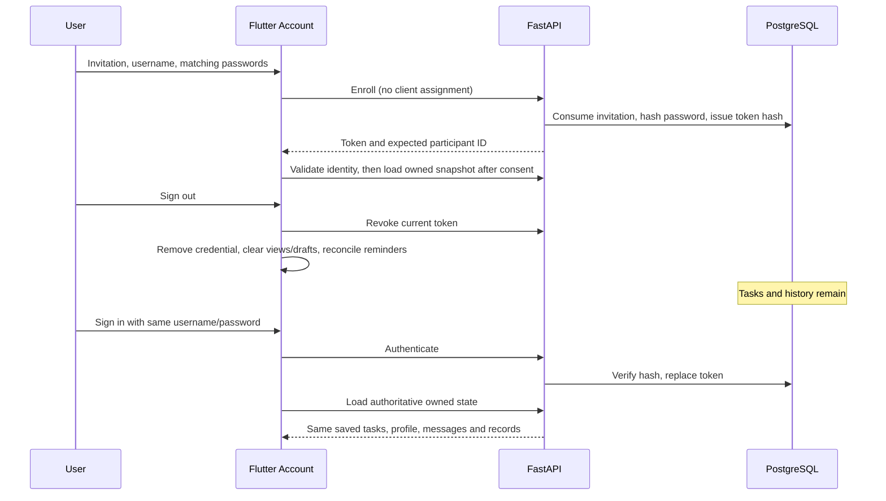

# Persistent user accounts — implementation and verification

Verified locally on 2026-11-04. This is a development research prototype, not an approved participant deployment.

## What existed and what changed

Existing invite-only enrollment, Argon2id passwords, token revocation, PostgreSQL ownership, secure mobile restoration and account-scoped pending messages were retained. Baseline: account tests **7 passed** (SQLite fallback); `flutter analyze` clean. Source inspection found normal sign-in exposing an editable development URL, enrollment missing password confirmation, and no combined returning-user test across backend reconstruction.

Changes:
- Normal Account screen uses `AppConfig.baseUrl`; users enter only username/password, plus invitation/password confirmation for enrollment. Advanced raw-token connections remain separate in development settings.
- Enrollment rejects mismatching confirmation before any request. Form secrets clear when changing mode; a synchronous busy guard also prevents repeat submission.
- Sign-out explains that server tasks and conversations are retained.
- Added an isolated-database regression covering three conditions, logout, revoked credentials, backend recreation, login, identical restored snapshots, duplicate chat requests, context isolation and owned exports.

Files: `outputs/frontend/lib/features/account.dart`, `outputs/frontend/test/multi_user_test.dart`, `outputs/backend/tests/test_account_persistence.py`. No endpoint, prompt, assignment, database schema or migration change was necessary.

## Permanent versus temporary backends

Normal Windows backend: `127.0.0.1:8000`; emulator: `http://10.0.2.2:8000`. Read-only verification of actual `.env` selection confirmed `postgresql+psycopg`, database `small_steps`, Gemini configured, application role **not superuser/createdb/createrole**. `/health` returned `ok`, `gemini`. Configuration defaults to SQLite in a fresh unconfigured clone; do not assume PostgreSQL merely from this report.

The previous live DEV-UI demonstration on port 8767 is a temporary test-schema server, not permanent enrollment. No identities, credentials or conversations were copied from it. This change does not reset existing passwords or convert token-only accounts into username/password accounts.

Automated PostgreSQL tests use `small_steps_test`, a separate role and disposable `qa_<uuid>` schemas. The HTTP fixture on port 8766 uses that isolation and **mock AI**. Neither fixture is the normal application database.

## Account and session model

- `Participant.id`: server-side pseudonymous owner, active status, condition, consent, profile and one bearer-token hash/expiry.
- `LoginAccount`: lowercase unique username, participant relationship and Argon2id hash. No plaintext password storage.
- `Invitation`: hashed single-use expiring code; condition fixed by trusted local provisioning before enrollment.
- Tasks, records and AI jobs are scoped by authenticated participant. Old tables use logical ownership checks; login/invitation relationships also have database foreign keys.
- Enrollment accepts no client role, condition or participant ID. Consent acknowledgement is a separate demonstration step.

Login replaces the previous token hash: **one active bearer session per account**, not LINE-style simultaneous multi-device sessions. Expiry defaults to seven days; there is no refresh-token mechanism. Sign in again to renew. Unknown, wrong-password and disabled accounts return generic errors. The current limiter is bounded single-process memory, not a deployment-grade distributed limiter.



## Ownership, AI and restoration

`AccountScreen.submit` → `ApiResearchRepository.authenticateAccount` → `/api/auth/enroll` or `/login` → `AppController.connectBackend` → authenticated participant validation → consent or `/api/state`. Restoration validates both expected ID and condition. Native credentials use existing secure storage; web uses memory only and requires login after reload.

`/api/state` currently loads all owned tasks and event/check-in/chat records without pagination; no older chat is intentionally discarded by this snapshot. This can become expensive for large accounts. Conversation search covers loaded history only. Gemini prompt context is deliberately bounded (recent task conversation turns, up to 50 task summaries and 100 recent events); full restored history does not mean all historical messages are sent to Gemini.

Gemini keys remain backend-only. Selected task ownership is validated. AI request IDs and histories are participant-scoped; Self-only future notes are filtered from Friend context. Standard control is blocked from AI endpoints. AI suggestions require explicit validated approval before task changes. No persona prompt changed. Failed live AI is not replaced by scripted demo output.

`signOutAccount` refuses active focus/requests, attempts revocation, then disconnects and removes remembered credentials. Offline logout warns that server revocation was not confirmed. Account-specific views/drafts clear; old pending attempts/reports stay bound to their original cache owner. Existing reminder scope reconciliation cancels/invalidates departing-account reminders. Logout is neither account deletion nor data erasure. Secure-storage failure handling suppresses automatic restore where device preferences remain writable; failure of both stores cannot guarantee durable credential cleanup.

## What is actually preserved

| Data | Storage / scope | Returning login |
|---|---|---|
| Tasks, subtasks, plans, difficulty, future notes | Owned server task JSON | Snapshot restores |
| Committed chats, suggestion decisions, check-ins, research events | Owned server records / AI jobs | Snapshot/export as implemented |
| Goal and support profile | Participant profile | Server restores |
| Focus reports | Owned event records once synchronized | Records retained; not a cross-device live timer |
| Active focus deadline and pending messages/events | Device account cache | Same device/owner only; not a universal offline outbox |
| Reminders, quiet hours, pauses | Device settings scoped by backend/account; OS schedule | Same-device reconciliation; not cross-device sync |
| Language / theme | Device/application state | Do not promise server synchronization |
| Unsent composer drafts / reading offsets | Account/conversation RAM | Lost on logout/process exit |

Local research-text caches are not encrypted by SharedPreferences. Token security does not secure all cached content. No general offline merge engine, background server synchronization or password recovery delivery exists.

## Setup and trying two accounts

1. Start the configured permanent backend from `outputs/backend` with `./RUN-BACKEND.cmd`. Keep the existing ignored `.env`; never paste its secrets into Flutter. See [PostgreSQL setup](POSTGRESQL_SETUP.md).
2. A trusted local operator issues **new** synthetic invitations (commands below). Existing IDs/output files are refused. Deliver codes privately; do not use real personal passwords or publish invitations.
3. In the app: **Settings → Account / Sign in → Have an invitation? Create account**. Enter the invitation, username, password and confirmation. Complete the separate demonstration acknowledgement.
4. Create a task and chat using the assigned agent. **Account → Sign out**. Sign in with the same username/password: saved server data returns. Signing in as the other enrolled user loads that user's data instead.
5. Do not enter a raw bearer token or backend URL in normal Account. Configure build-time `API_BASE_URL` for other environments; release/distribution needs HTTPS. Default Android URL is for the emulator, not a physical phone.

From `outputs/backend`, operator-only commands (run only when intentionally creating new synthetic application records):

```powershell
.\.venv\Scripts\python.exe -m app.admin invite --id TEST-RETURN-A --condition selfAgent --token-file .tmp/invitation-return-a.json
.\.venv\Scripts\python.exe -m app.admin invite --id TEST-RETURN-B --condition friendAgent --token-file .tmp/invitation-return-b.json
```

These commands are instructions, not a claim these permanent users were created during this change. Existing application records were not modified. The old DEV-UI accounts were not reused. For approved participants, study deployment/consent configuration remains blocked pending protocol and operational review.

## Executed checks

Environment: Windows, Flutter 3.47.4 / Dart 3.13.3, Python 3.12.14, PostgreSQL 18.6. Synthetic data and mock AI used for all new behavioral tests.

| Check | Result |
|---|---|
| Baseline `pytest tests/test_accounts.py -q` | PASS: 7, SQLite fallback |
| Baseline and final `flutter analyze` | PASS, no issues |
| PostgreSQL account + new restart regression | PASS: 8 |
| Full `pytest -q` with isolated PostgreSQL URL | PASS: 96; existing Starlette/httpx deprecation warning |
| `ruff check app tests`, `pip check` | PASS |
| Changed Dart formatting | PASS |
| Full `flutter test` | PASS: 211, 14 explicitly skipped opt-in tests |
| Opt-in Dart/Dio HTTP contract tests against isolated PostgreSQL mock fixture | PASS: 6 |
| `tool/build-apk.ps1` | PASS: Flutter compilation plus verified Gradle packaging; existing Gradle/Kotlin deprecations |
| API 35 emulator | PASS: booted, updated APK installed/launched; temporary DEV-UI account signed out; Sign in/Create account visually inspected, including confirmation/invitation and absence of URL field |
| New live Gemini calls | NOT TESTED; no provider calls made in this change |
| Physical notification delivery / iPhone compilation | NOT TESTED; Windows environment |

APK: `outputs/frontend/SmallSteps-debug.apk`, SHA256 `114712BC58591A6FB6C4D10D3F852607F09ABD448ABD2351D72AC8AF8AF7232A`. Build receipt stays in ignored `.tool-state/verified-android-build.json`.

The restart regression recreates the FastAPI app and database engine against the same isolated schema; it is not a PostgreSQL-service reboot or native application restart test. Existing Flutter restoration tests use a memory secure-store substitute. Native authenticated returning login against the permanent server still requires a privately enrolled username/password; this work does not recover or reset old credentials.

## Remaining requirements

### Follow-up live smoke check and publication

After the account implementation checks, two additional synthetic live Gemini requests were executed on a fresh isolated PostgreSQL test schema, port **8768** (not the permanent server): Self-Agent through HTTP, Friend-Agent through the native Android composer. Both returned HTTP-successful committed conversations. Export provenance was `gemini`, `gemini-3.1-flash-lite`, with the matching condition. Each account contained exactly two messages (one user and one agent), and guessed cross-account task IDs returned 404. Friend replied with an optional title/goal starting step; Self offered an optional sentence/bullet starting step. These examples establish connectivity, not comprehensive persona quality or procrastination efficacy.

The API 35 app was force-stopped and cold-launched; secure synthetic Friend-account restoration and its saved conversation were checked in Chat. This fixture is temporary and must not be mistaken for permanent enrollment. No permanent account was reset, reprovisioned or changed. Earlier full tests/build above were not redundantly rerun because application/test sources had not changed since those successful checks. Only this evidence note was added. Secrets, fixture credentials, database files, screenshots and APK remain excluded from publication.

Before participants: approved consent/instruments and deployment design; HTTPS and reachable backend; reviewed recovery/support process; distributed abuse protection; encrypted device-data/backup/retention policies; physical reminder and Keychain checks; history scalability testing. Native Gemini quality, multi-device sessions and perfect synchronization are not established by these tests.
