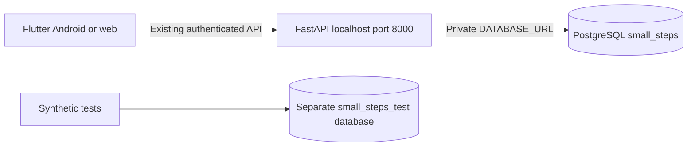

# PostgreSQL connection — Small Steps

Completed locally on 2026-11-02. PostgreSQL **18.6**, Windows service `postgresql-x64-18`, port **5432**. The backend now uses PostgreSQL through SQLAlchemy and Psycopg 3.3.6. Flutter still connects to FastAPI, never directly to the database. Stack Builder add-ons are not needed for this connection.

## Current configuration



- Application database: `small_steps`, owner/login `small_steps_app`.
- Test database: `small_steps_test`, owner/login `small_steps_test_user`.
- Neither login is a superuser, role administrator or database creator. They cannot connect to each other's database; verified.
- The installer administrator password was entered in a local hidden prompt. The setup helper does not save it.
- Random application/test credentials are saved only in ignored private `.tmp/postgres-connection.json`. The application URL is also in ignored `.env`, replacing only `DATABASE_URL`; provider configuration was preserved.
- This backend binds to `127.0.0.1:8000`. Database connections use `127.0.0.1:5432`. External database connectivity and production TLS/firewall configuration were not tested. Do not expose this development setup publicly.

## Preserved data

The backend was stopped during the cutover (nothing was listening on port 8000). An SQLite backup was made with the SQLite backup API before copying. The target was checked for existing application records and refused if populated. All rows were copied transactionally; PostgreSQL sequences were advanced to preserve future inserts.

Copied and compared field-for-field against the SQLite backup:

| Table | Rows |
|---|---:|
| participants | 2 |
| tasks | 5 |
| records | 71 |
| ai_jobs | 25 |
| login_accounts | 0 |
| account_invitations | 0 |

The original users had token-based accounts; there were no username/password accounts or invitations in the source database. Existing tokens remain valid: authenticated `/api/participants/me` and `/api/state` returned HTTP 200 after the switch. New invite-only accounts can now be issued using the existing local CLI.

The original SQLite database was left in place. Private backups and row-count receipt are under backend `.tmp/`: `postgres-cutover-receipt.json` identifies the SQLite and environment backup filenames. These files may contain sensitive data or credentials and must stay out of Git. SQLite is no longer the active backend store; it will not receive new PostgreSQL writes.

## Start and verify

From `outputs/backend`:

```powershell
.\RUN-BACKEND.cmd
```

The service is already running after this setup. On later restarts, use that command, and check `http://127.0.0.1:8000/health`. The health endpoint checks a database query; its current payload does not identify the database type. The setup additionally verified the active SQLAlchemy dialect, PostgreSQL server version, application role privileges and backend database sessions directly.

The PostgreSQL Windows service must also be running. Keep the application's existing backend address: emulator `http://10.0.2.2:8000`; local web `http://127.0.0.1:8000`. No Flutter rebuild is required merely for a server-side database change.

## Run PostgreSQL tests safely

From `outputs/backend`, load the private test URL into an environment variable without printing it:

```powershell
$privateConnection = Get-Content .tmp/postgres-connection.json -Raw | ConvertFrom-Json
$env:SMALL_STEPS_TEST_POSTGRES_URL = $privateConnection.test
.\.venv\Scripts\python.exe -m pytest -q
Remove-Item Env:SMALL_STEPS_TEST_POSTGRES_URL
```

The shared API fixture requires local database `small_steps_test`, creates a randomly named `qa_...` schema for each test and removes only that disposable schema afterward. It refuses the application database, remote hosts and caller-provided search-path options. Explicit legacy-SQLite migration tests and pure unit tests remain SQLite/unit checks even in this run. Tests never clear `small_steps`.

For Dart HTTP checks, set the same test environment variable before launching `tool/http_fixture.py`, then run the existing opt-in Flutter HTTP test command in another terminal. The fixture uses a disposable PostgreSQL schema and mock AI. Stop it afterward; it removes its temporary account file and schema. Without the test environment variable, the fixture retains its previous temporary SQLite behavior.

## Actual results

- Backend suite with PostgreSQL API fixtures: **93 passed**, one pre-existing Starlette/httpx deprecation warning.
- Dart/Dio → HTTP → FastAPI → PostgreSQL: **6 passed**, including all three conditions, invitation login/logout, task/refinement/chat contracts; AI mocked.
- Cross-database login restrictions: passed in both directions.
- Migration payload equality and sequence checks: passed.
- Live backend health, preserved-token authentication and owned-state reads: HTTP 200.
- Ruff checks and `pip check`: passed.

No real Gemini request was needed. PostgreSQL concurrency under production load, disaster recovery, automated backups, TLS deployment, physical notification delivery and iOS behavior were not established by these tests.

## Setup helpers and recovery

`CONNECT-POSTGRES.cmd` / `tool/setup_postgres.py` created the two databases and restricted roles. It refuses existing target roles/databases rather than changing their passwords or dropping them. It is bootstrap tooling, not a routine command to rerun after successful setup.

`tool/migrate_sqlite_postgres.py --server-stopped` performed the one-time copy and configuration switch. It refuses a populated PostgreSQL target. Do not rerun it to synchronize databases: no bidirectional database replication exists.

To investigate rollback, first stop the backend and compare any writes made since cutover. The old SQLite backup lacks newer PostgreSQL records. Do not blindly restore the old environment or erase either database. Plan and verify a reverse migration or restore into a separate database before changing the active configuration.

Official references: [PostgreSQL Windows packages](https://www.postgresql.org/download/windows/), [SQLAlchemy Psycopg dialect](https://docs.sqlalchemy.org/en/20/dialects/postgresql.html#module-sqlalchemy.dialects.postgresql.psycopg), [PostgreSQL connection options](https://www.postgresql.org/docs/current/libpq-connect.html).
