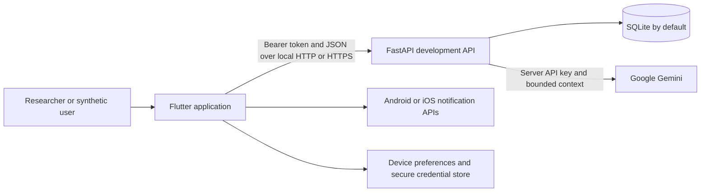
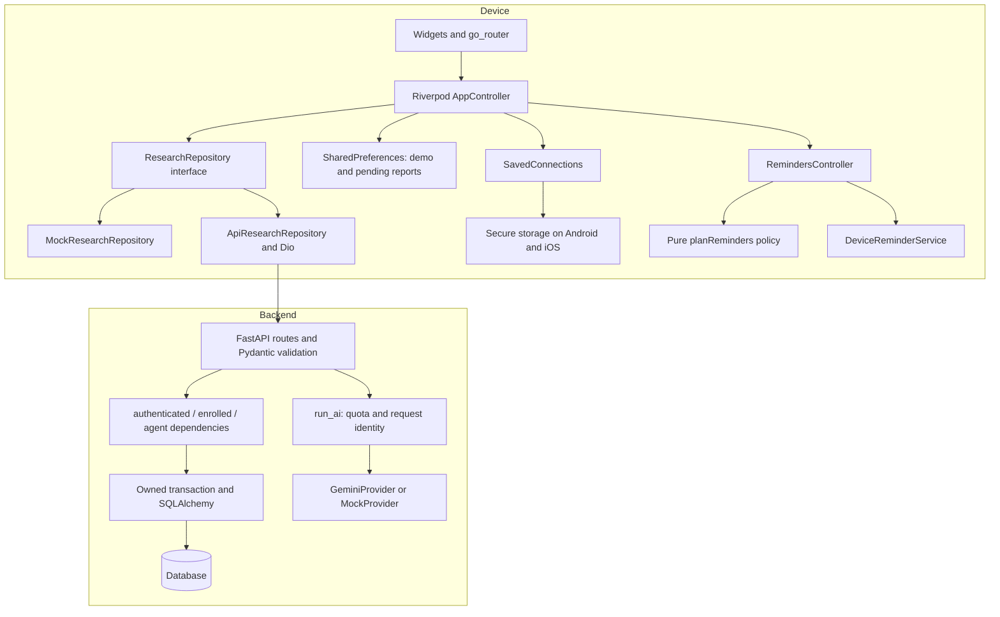
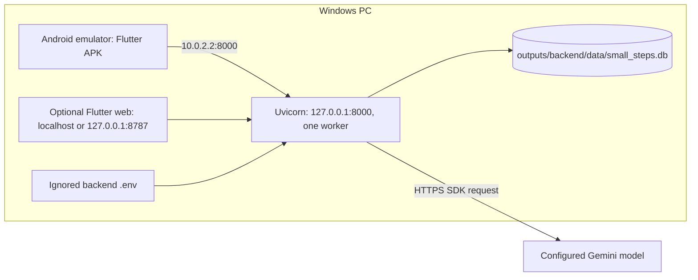
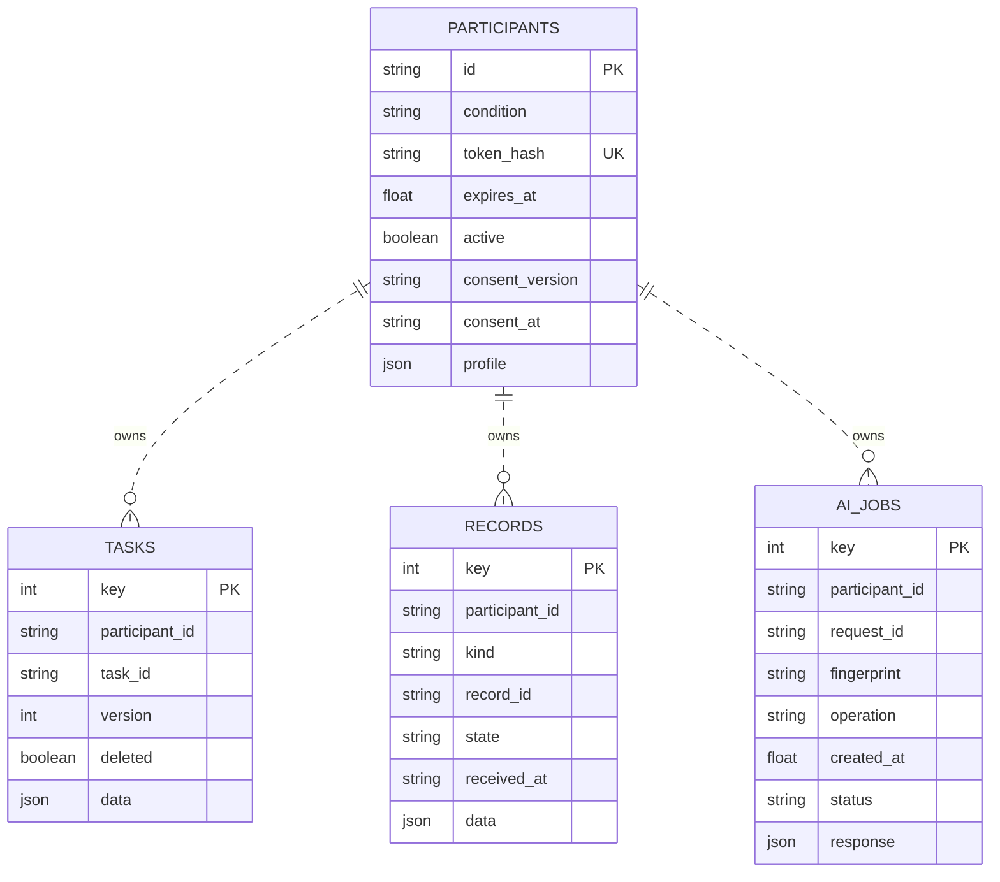
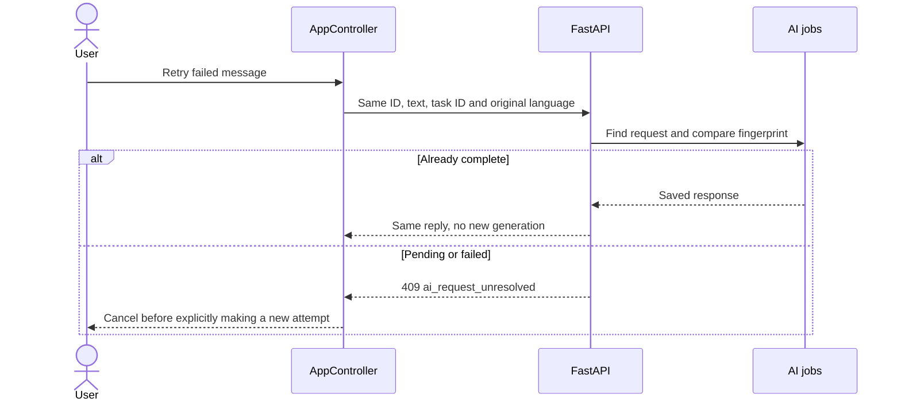

# System design

Verified against the implementation on 2026-11-02. Read [data and sync](DATA_AND_SYNC.md) for failure semantics and [QA](QA_AND_INTEGRATION_REPORT.md) for verification limits.

## Purpose and conditions

Small Steps supports task initiation and research into different styles of AI support. `StudyCondition` has `selfAgent`, `friendAgent`, and `standardControl`. The backend account owns the condition. Both agents share the same chat widget, model configuration and task capabilities; prompts differ. Control cannot call AI endpoints. `RESEARCHER_DEMO=false` deliberately routes to an unavailable-study screen; actual participant enrollment and approved instruments are missing.

Researcher Demo Mode has two distinct forms: local scripted demo state and connected synthetic development accounts. Remembered `DEV-` agent accounts on the same server can be switched in Chat. That is an account change with separate tasks/history, not a condition change for one participant.

## Context, components and trust boundaries



The device is a separate trust boundary from the backend. A Flutter choice is not authorization: FastAPI validates tokens, onboarding and ownership. Gemini is another boundary: task/profile text and recent conversation context leave the server for configured AI requests. Model text is untrusted; no model tools execute changes. A provider reply is not research evidence of improved self-control.



Frontend entry point: [main.dart](../outputs/frontend/lib/main.dart) initializes Flutter, preferences, font licensing and injected native services. [app.dart](../outputs/frontend/lib/app/app.dart) defines routes, lifecycle refresh, themes and localization. [state.dart](../outputs/frontend/lib/app/state.dart) coordinates business operations; widgets watch providers to rebuild. The repository switches to API only after a validated connection. The controller guards in-flight requests, focus and account transitions.

Backend entry: `uvicorn app.main:create_app --factory`. [main.py](../outputs/backend/app/main.py) creates settings, engine, provider, routes, middleware and dependencies. Request bodies are bounded to 64 KiB; Pydantic forbids extra fields. Validation errors identify fields without echoing sensitive input. Error handlers return a common envelope. Lifespan cleanup closes the provider and database engine.

## Actual local deployment



There is no verified cloud deployment. PostgreSQL is configurable through SQLAlchemy/psycopg but is not verified here. SQLite uses WAL and a 20-second connection timeout. `create_all` creates tables; there is no migration framework. Local HTTP is accepted only for localhost/emulator addresses by the client; remote URLs require HTTPS. A physical phone needs suitable connectivity; its own `127.0.0.1` is not the PC.

## Stored data and relationships



These are **logical ownership relationships**, not declared SQL foreign keys. Ownership is enforced in queries/transactions. Unique constraints cover `(participant_id, task_id)`, `(participant_id, kind, record_id)` and `(participant_id, request_id)`. Task fields/subtasks and conversation turns are JSON, not separate task-detail or message tables. Records include client events, server audits, check-ins, chat turns and suggestions; suggestion status can change despite other records being append-oriented. Device preferences and credentials are not relational tables.

## Sequence 1: create/update task

```mermaid
sequenceDiagram
  actor User
  participant UI as TaskEditor
  participant C as AppController
  participant R as API repository
  participant API as FastAPI
  participant DB as Database
  User->>UI: Save task
  UI->>C: saveTask(task)
  C->>R: create version 1 or update current+1
  R->>API: POST /api/tasks or PATCH /api/tasks/id
  API->>DB: Validate owner; insert or compare-and-swap
  DB-->>API: Commit task and server audit
  API-->>C: Authoritative task receipt
  C->>C: Replace task; record client report; persist
  C-->>UI: Provider rebuild
  Note over C,API: Identical update replay is accepted; different stale edit is 409
```

## Sequence 2: chat

```mermaid
sequenceDiagram
  actor User
  participant UI as ChatScreen
  participant C as AppController
  participant API as FastAPI
  participant DB as Database
  participant AI as Gemini
  User->>UI: Send message
  UI->>C: send(text, task)
  C->>C: Save pending user message and stable request ID
  C->>API: POST /api/chat, Idempotency-Key
  API->>DB: Validate assignment; reserve AI job
  API->>DB: Read owned task/profile/history
  API->>AI: Persona plus delimited context and language
  AI-->>API: Text response
  API->>DB: Store turn, provenance and completed job
  API-->>C: Agent message
  C->>C: Mark user sent; append reply; persist
  C-->>UI: Render bubbles
```

## Sequence 3: chat retry



The backend exposes request-status lookup, but the chat UI does not automatically poll it. Do not interpret retry as unconditional regeneration.

## Sequence 4: switch live synthetic account

```mermaid
sequenceDiagram
  actor User
  participant UI as Chat selector
  participant C as AppController
  participant V as Secure saved accounts
  participant API as FastAPI
  User->>UI: Tap other agent
  UI->>C: switchLiveAgent(target)
  C->>V: Read separately remembered target login
  C->>API: Validate target identity and assignment
  C->>C: Flush current reports; disconnect; keep Chat route
  C->>API: Authenticate target and GET /api/state
  API-->>C: Target's own tasks and history
  C->>V: Save selected account
  C-->>UI: Show target agent and separate history
  Note over C,API: Failure before transition leaves current account; later failure attempts rollback
```

## Sequence 5: saved-login restoration

```mermaid
sequenceDiagram
  participant App as App startup
  participant V as SavedConnections
  participant API as FastAPI
  App->>V: Read active synthetic login from secure store
  V-->>App: URL, token, expected ID and condition
  App->>API: GET /api/participants/me
  API-->>App: Authenticated identity and assignment
  App->>App: Check both expected ID and condition
  alt Valid and reachable
    App->>API: GET /api/state
    API-->>App: Authoritative account data
  else Invalid, expired or offline
    App->>App: Show reconnect error; block chat/task writes/refinement
  end
```

## Sequence 6: accepted correction

```mermaid
sequenceDiagram
  actor User
  participant UI as CorrectionSheet
  participant API as FastAPI
  participant AI as Provider
  participant DB as Database
  UI->>API: POST /api/tasks/refine, mode correction
  API->>AI: Propose bounded title, description and duration
  AI-->>API: Validated proposal
  API->>DB: Store suggestion and task snapshot
  API-->>UI: Editable draft
  User->>UI: Edit and explicitly accept
  UI->>API: POST /api/refinements/id/accept
  API->>DB: Check owner, proposed state and task version; commit approved fields
  API-->>UI: Updated task receipt
```

## Sequence 7: reminder reconciliation and opening

```mermaid
sequenceDiagram
  actor User
  participant C as Task controller
  participant N as RemindersController
  participant OS as Native notifications
  User->>C: Choose reminder / edit / complete task
  C->>N: Task provider changes
  N->>N: Check scope, consent, preferences, permission, timezone and policy
  N->>OS: Replace pending schedule; remove ineligible displayed notifications
  OS-->>N: Scheduling API returned
  N->>C: notification_schedule_registered, not delivery evidence
  User->>OS: Tap notification
  OS->>N: Scoped task/category payload
  N->>C: Validate account and report opened callback
  C-->>User: Open task or request account connection
```

No backend push service or background model generation exists. Native delivery is inexact and affected by OS settings; reconciling on resume cannot prove terminated delivery.

## Sequence 8: focus background/resume

```mermaid
sequenceDiagram
  actor User
  participant UI as FocusScreen
  participant C as AppController
  participant Store as Device cache
  User->>C: Start focus
  C->>C: deadline = now + remaining seconds
  C->>Store: Persist session and focus_started report
  UI->>UI: App backgrounded; ticker may stop
  User->>UI: Resume app
  UI->>C: Read remainingAt(now)
  C-->>UI: Clamp deadline difference to session duration
  User->>C: End session or save elapsed session
  C->>Store: Save focus event; clear session
  Note over C,Store: Timer expiry never marks the task complete
```

## Localization and analysis

`LanguageController` persists `en`/`ja`. Generated ARB localizations configure Material/Cupertino widgets, dates and UI. Chat retries keep the message's original requested language; old task/chat content is unchanged. Notification language updates copy under the same scheduling policy. `futureNote` is selected-task context only for Self-Agent; Friend-Agent context removes that field. Context is bounded to 50 task summaries, 100 recent events and up to 10 relevant decisions; history uses the last 10 matching turns within the most recent 500 chat records.

Insights count self-reports and timer starts; they do not calculate a validated procrastination score or causal intervention effect. There is no automatic approved time-to-start analysis. See the researcher manual before interpreting exports.

## Limits

Single-worker local service, serialized AI generation, no distributed queue, no schema migrations, no real signup/refresh, no approved consent/instruments, no general offline task outbox, no multi-device realtime updates, no push receipts, no clinical outcomes established. Full-state snapshots grow with account records and are not paginated. Client/server duplicate representations require careful analysis. Source fixes and build checks reduce known failures; they do not establish perfect synchronization.
